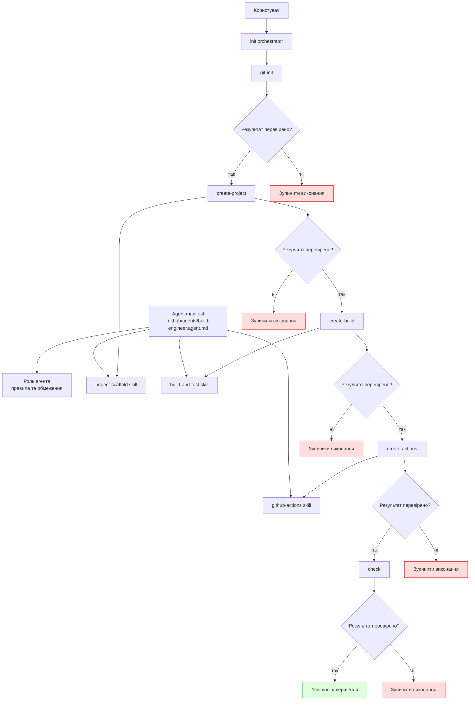

# Архітектурна специфікація AI-агента для лабораторної роботи №1

## 1. Загальні відомості

- Студентка: Вероніка Михальченко
- Група: КІ-407
- Номер у списку: 13
- Варіант: 1
- Мова програмування: C++
- Система складання: CMake
- Тестування: GoogleTest / CTest
- Середовище розробки: VS Code із GitHub Copilot
- Репозиторій: ai-agent-cpp-lab1
- Гілка: develop

## 2. Призначення AI-агента та проблеми, які він вирішує

AI-агент призначений для автоматизації створення базового кросплатформного проєкту на C++ у межах лабораторної роботи. Його основна мета — зменшити ручну рутину, забезпечити стандартизовану структуру проєкту та гарантувати, що результат автоматично проходить базову перевірку на платформах Windows, Linux і macOS.

Проблеми, які вирішує агент:

- створення початкової структури проєкту з чітко визначеними каталогами;
- генерація конфігурації CMake для кросплатформного збірки;
- створення базового Hello World додатку та тесту BasicAddition;
- налаштування запуску GoogleTest / CTest у CI;
- генерація GitHub Actions для трьох ОС з використанням платформо-специфічних скриптів;
- забезпечення безпечного та повторюваного виконання команд без приховування помилок;
- гарантування, що результат зберігається у репозиторії без потрапляння секретів або артефактів складання до Git.

Агент є спеціалізованим інструментом для інженера з автоматизації збірки, а не універсальним генератором коду. Він працює лише в рамках визначеної лабораторної задачі і має обмежене коло відповідальності.

## 3. Очікувана структура проєкту

Проєкт повинен мати таку структуру:

```text
.github/
  agents/
    build-engineer.agent.md
  skills/
    project-scaffold/
      SKILL.md
    build-and-test/
      SKILL.md
    github-actions/
      SKILL.md
  prompts/
    git-init.prompt.md
    create-project.prompt.md
    create-build.prompt.md
    create-actions.prompt.md
    check.prompt.md
    init.prompt.md
  workflows/
    ci.yml
src/
  main.cpp
tests/
  CMakeLists.txt
  BasicAdditionTest.cpp
CMakeLists.txt
README.md
.gitignore
ci.sh
ci.bat
docs/
  architecture.md
  usage.md
```

Це мінімальна структура за методичними вказівками для лабораторної роботи: `.github/agents`, `.github/skills`, `.github/prompts`, `.github/workflows`, `src`, `tests`, `docs`, кореневий `CMakeLists.txt`, `README.md`, `.gitignore`, а також скрипти `ci.sh` і `ci.bat`. Локальні каталоги `build/` або `out/` можуть з’являтися як результати складання, але не є обов’язковим елементом проектної структури на цьому етапі.

## 4. Manifest агента: `.github/agents/build-engineer.agent.md`

### 4.1. Роль

Роль агента: `build-engineer`.

Агент виконує функції спеціалізованого інженера з автоматизації зборки та CI/CD для C++-проєктів. Він відповідає за проектування, підготовку, перевірку та документування базового життєвого циклу проєкту: ініціалізація репозиторію, генерація структури проекту, конфігурація CMake, запуск тестів і підготовка GitHub Actions.

### 4.2. Область відповідальності

Агент відповідає лише за:

- ініціалізацію Git-репозиторію;
- створення каркасу проєкту на C++;
- конфігурацію CMake для кросплатформної збірки;
- створення базового `Hello World` додатку;
- додавання тесту `BasicAddition` з GoogleTest / CTest;
- підготовку GitHub Actions для Windows, Linux і macOS;
- перевірку результату з допомогою локальних або CI-скриптів;
- фіксування стану проєкту в документації та інструкціях.

### 4.3. Правила роботи з файлами

- Генерувати лише необхідні файли, сумісні з лабораторною задачею.
- Зберігати структуру каталогів у відповідності до методичних вказівок.
- Не змінювати `README.md`, якщо це не є необхідною частиною завдання.
- Кожен новий файл має мати чіткий сенс і відповідати функціональній ролі у проєкті.
- Уникає дублювання логіки між файлами.
- Для локальних артефактів збірки використовує `build/` або еквівалент, але не переносить їх до Git.

### 4.4. Обмеження

- Не є універсальним розробником для веб-, мобільних або ML-інфраструктур.
- Не створює надлишкову абстракцію понад межі лабораторної задачі.
- Не виконує комміти, push, зміни захисту гілок або примусове переписування історії Git.
- Не використовує секрети у локальному коді або в конфігурації workflow без явної вимоги.

### 4.5. Заборонені дії

Агент не має права:

- видаляти або змінювати файли без попереднього аналізу наслідків;
- автоматично очищати репозиторій з ризиком втрати важливих даних;
- передавати секрети у `GitHub Actions`, логи, команди або файли проєкту;
- використовувати `git push --force` або переписувати історію без явного дозволу;
- змінювати захист гілок або правила безпеки у репозиторії без прямої інструкції;
- запускати небезпечні операції по типу повного видалення директорії проєкту без мітки перевірки.

### 4.6. Критерії завершення

Агент вважається завершившим роботу лише тоді, коли:

- створено базовий C++ проєкт із Hello World;
- налаштовано CMake і CTest;
- тест BasicAddition проходить у локальному середовищі;
- GitHub Actions налаштовано для ubuntu-latest, windows-latest і macos-latest;
- CI-скрипти запускають збірку та тести;
- артефакти збірки знаходяться у `build/` або схожій директорії і не потрапляють до Git;
- всі перевірки виконано без приховуваних помилок.

## 5. Skills

Усі skills мають бути описані в структурі `.github/skills/` з окремою директорією на кожен skill і файлом `SKILL.md` всередині неї:

- `.github/skills/project-scaffold/SKILL.md`
- `.github/skills/build-and-test/SKILL.md`
- `.github/skills/github-actions/SKILL.md`

Це є офіційною структурою для лабораторної роботи і визначає окремі інструкції агента для різних етапів проєкту.

### 5.1. Skill: `project-scaffold`

#### Призначення

Створити каркас проєкту на C++ із початковою структурою каталогів, кореневими файлами конфігурації та базовим Hello World.

#### Вхідні параметри

- назва проєкту;
- мова: `C++`;
- вхідний рядок користувача або параметр генерації;
- шлях до репозиторію;
- бажана структура каталогів;
- базовий тип застосунку: Hello World.

#### Очікувані результати

- створені директорії `src/`, `tests/`, `docs/` та інші необхідні папки;
- створені базові файли `CMakeLists.txt`, `main.cpp` або аналогічні;
- наявність мінімального робочого Hello World;
- підтримка структури, сумісної з GoogleTest / CTest.

#### Способи перевірки

- перевірити, що файли існують і мають правильні шляхи;
- виконати конфігурацію CMake;
- зібрати проєкт;
- виконати Hello World binary і перевірити стандартний вихід.

#### Дії у випадку помилки

- зупинити потік генерації;
- показати точну причину помилки;
- не створювати додаткові файли, якщо початковий шаблон генерування вже зламався;
- повторно перевірити параметри проєкту та шляхи до каталогів.

### 5.2. Skill: `build-and-test`

#### Призначення

Налаштувати збірку, скомпілювати проєкт і виконати базові тести, зокрема `BasicAddition`.

#### Вхідні параметри

- конфігурація CMake;
- список цілей збірки;
- шлях до збірки (`build/` або `out/`);
- список тестів для виконання;
- інформація про компілятор і платформи.

#### Очікувані результати

- успішна конфігурація CMake;
- побудова виконуваних файлів;
- наявність тестового набору через GoogleTest / CTest;
- виконання `BasicAddition` і отримання статусу PASS.

#### Способи перевірки

- `cmake -S . -B build`;
- `cmake --build build`;
- `ctest --test-dir build --output-on-failure`;
- запуск виконуваних тестів і перевірка суми.

#### Дії у випадку помилки

- зафіксувати помилку компіляції або виконання;
- не маскувати збій у тестах;
- перевірити змінені файли `CMakeLists.txt`, `main.cpp` або тестові файли;
- зупинити наступні етапи orchestrator, якщо критична складова не виконана.

### 5.3. Skill: `github-actions`

#### Призначення

Підготувати CI/CD-конфігурацію для автоматизованої перевірки проєкту на трьох ОС.

#### Вхідні параметри

- платформи: `ubuntu-latest`, `windows-latest`, `macos-latest`;
- шляхи до файлів `ci.sh`, `ci.bat` або їх аналогу;
- інформація про кросплатформний запуск складання;
- правила для збереження артефактів і виконавчих файлів.

#### Очікувані результати

- створений `ci.yml` в `.github/workflows/`;
- правильна матриця викликів для трьох операційних систем;
- сценарії запускають збірку, тести та генерують виконувані файли;
- локальні артефакти не потрапляють у Git.

#### Способи перевірки

- перевірити синтаксис workflow;
- переконатися, що job викликає відповідний платформо-специфічний сценарій;
- перевірити, що workflow містить кроки збірки та запуску тестів;
- переконатися, що `build/` не є частиною комміту або push.

#### Дії у випадку помилки

- зупинити конфігурацію workflow, якщо платформа не має відповідного сценарію;
- виправити помилки в скриптах для Windows/Linux/macOS;
- забезпечити, щоб сценарії не містили жорстко закодованих секретів;
- підтвердити відсутність небезпечних директив для `git` або захисту гілок.

## 6. Commands

Команди є окремими атомарними операціями, які використовуються orchestrator. Усі prompt-файли зберігаються в `.github/prompts/` під іменами:

- `git-init.prompt.md`
- `create-project.prompt.md`
- `create-build.prompt.md`
- `create-actions.prompt.md`
- `check.prompt.md`
- `init.prompt.md`

### 6.1. Команда: `git-init`

#### Передумови

- репозиторій доступний у локальній директорії;
- користувач має права на створення/змінення файлів;
- не існує критичних конфліктів із вже створеним репозиторієм.

#### Дії

- перевірити статус Git;
- ініціалізувати репозиторій, якщо необхідно;
- визначити й повідомити поточну Git-гілку, на якій виконується робота;
- перевірити стан каталогу та його чистоту;
- запобігти випадковому зміненню захисту гілок або історії Git без явного дозволу.

#### Очікувані файли

- `.git/` або репозиторій, готовий до подальшої роботи;
- `.gitignore` з правилами для `build/` і виконавчих файлів.

#### Перевірки

- `git status` показує коректний стан репозиторію;
- команда фіксує та повідомляє поточну гілку Git, не вимагаючи обов’язково `develop`;
- у каталозі немає невизначених конфліктів або блокувань.

#### Помилки

- якщо репозиторій вже існує в нестабільному стані, команда вказує на проблему і зупиняється;
- якщо прав на запис недостатньо, команда не продовжує виконання.

### 6.2. Команда: `create-project`

#### Передумови

- git-репозиторій ініціалізовано;
- відомі назва проєкту, мова та необхідна структура.

#### Дії

- створює основні директорії `src/`, `tests/`, `docs/` та інші модулі;
- генерує `CMakeLists.txt` верхнього рівня;
- створює базовий `main.cpp` з Hello World;
- додає базову структуру коду відповідно до проектної задачі;
- використовує skill `project-scaffold` для стандартизованого каркасу.

#### Очікувані файли

- `CMakeLists.txt`;
- `src/main.cpp`;
- `src/...` або `app/...` залежно від структури;
- `docs/architecture.md`;
- `docs/usage.md`.

#### Перевірки

- файл існує і його зміст відповідає стандарту CMake;
- програма компілюється і виконується без помилок.

#### Помилки

- відсутність `CMakeLists.txt` або некоректна структура каталогів;
- неправильне використання збірки для Hello World;
- конфлікт файлових шляхів.

### 6.3. Команда: `create-build`

#### Передумови

- проєкт створено;
- існує базовий CMake-файл;
- структура проєкту готова до компіляції.

#### Дії

- конфігурує проєкт через CMake;
- виконує збірку;
- створює або підключає GoogleTest;
- формує тест `BasicAddition` в `tests/`;
- запускає `ctest`;
- використовує skill `build-and-test` для підтвердження складання та стану тестів.

#### Очікувані файли

- `build/` або `out/` з скомпільованими артефактами;
- `tests/CMakeLists.txt`;
- `tests/BasicAdditionTest.cpp`;
- `build/CTestTestfile.cmake` та інші файли CTest.

#### Перевірки

- `cmake -S . -B build` успішно виконується;
- `cmake --build build` завершується без помилок;
- `ctest --test-dir build --output-on-failure` проходить.

#### Помилки

- помилки компіляції C++ або CMake;
- відсутність тестового виконуваного файлу;
- збій у `BasicAddition` або неправильна логіка тесту.

### 6.4. Команда: `create-actions`

#### Передумови

- проєкт успішно збирається локально;
- відомі платформи для перевірки;
- структура GitHub Actions визначена.

#### Дії

- створює `.github/workflows/ci.yml`;
- додає одну job з matrix для `ubuntu-latest`, `windows-latest` і `macos-latest`;
- створює або підключає скрипти `ci.sh` і `ci.bat`;
- забезпечує запуск складання, тестів та генерації виконуваних файлів;
- використовує skill `github-actions` для налаштування CI/CD.

#### Очікувані файли

- `.github/workflows/ci.yml`;
- `ci.sh` для Linux/macOS;
- `ci.bat` для Windows;
- артефакти, зібрані через `upload-artifact`.

#### Перевірки

- workflow містить matrix для трьох ОС;
- три платформи запускають відповідні сценарії;
- сценарії виконують кроки збірки та тестування;
- workflow запускається на `push` і `pull_request` до `develop` або `main`.

#### Помилки

- відсутність сценаріїв для конкретних ОС;
- несумісність шляхів або команд;
- помилки в секціях `uses`, `run` або matrix;
- копіювання секретів або конфіденційних даних в YAML і скрипти.

### 6.5. Команда: `check`

#### Передумови

- попередні команди були успішно виконані;
- проєкт і CI готові до перевірки.

#### Дії

- перевіряє наявність Hello World виконуваного файлу;
- перевіряє прохід тестів `BasicAddition`;
- перевіряє роботу CTest;
- перевіряє структуру проєкту, `manifest`, `skills`, `commands`, CMake, тести, YAML workflow;
- перевіряє відсутність небажаних файлів у Git;
- не змінює вихідний код, конфігурації, документацію та структуру проєкту, а лише перевіряє їх стан.

#### Очікувані файли

- складання в `build/`;
- лог файли або статусні звіти перевірок;
- відсутність конфіденційних даних у репозиторії.

#### Перевірки

- `Hello World` виконується на всіх трьох ОС;
- `BasicAddition` проходить;
- CTest повертає статус успіху;
- Git не містить артефакти збірки та секрети.

#### Помилки

- помилки рівня виконання або тестів;
- невдало налаштований `.gitignore`;
- витік секретів або змін у захисті гілок;
- зміни в коді, конфігурації або документації під час перевірки без явної вимоги.

### 6.6. Команда: `init`

#### Передумови

- користувач явно запускає orchestrator `init`;
- репозиторій готовий до послідовного виконання команд;
- попередні етапи не були виконані або вимагають повторної перевірки.

#### Дії

- запускає послідовність `git-init → create-project → create-build → create-actions → check`;
- після кожного кроку перевіряє результат;
- зупиняється при першій помилці без приховування причин;
- не перевизначає коректні файли без перевірки та без повторного підтвердження.

#### Очікувані результати

- повний потік створення проєкту завершено без критичних відхилень;
- структура, конфігурації та CI відповідають лабораторній роботі;
- повторний запуск `init` є безпечним і не дублює конфігурації без перевірки.

#### Помилки

- помилка на будь-якому етапі призводить до зупинки;
- повторний запуск не стирає попередні коректні файли без попередньої перевірки;
- відхилення в структуру або назви файлів блокують подальші кроки.

## 7. Orchestrator-команда `init`

Команда `init` є головною керуючою послідовністю. Вона виконує повний цикл у строгій послідовності:

1. `git-init`
2. `create-project`
3. `create-build`
4. `create-actions`
5. `check`

### Вимоги до `init`

- зупинятися при будь-якій помилці на будь-якому етапі;
- не приховувати помилки і не виконувати “продовження за замовчуванням”;
- зберігати зрозумілий журнал станів кожної команди;
- бути безпечним для повторного запуску, тобто повторний запуск не повинен знищувати вміст проєкту без підтвердження;
- не видаляти файли у процесі повторного виконання, якщо вони вже створені і валідні;
- не перезаписувати коректні файли без перевірки та не дублювати конфігурації.

### Правила повторного запуску

- якщо попередній етап завершився успішно, повторний запуск не повинен заново генерувати конфліктуючі дані, які можуть переписати коректний результат;
- якщо певний файл вже існує, система перевіряє його стан і вирішує: оновити, пропустити або відмовити;
- якщо виявлено помилку, `init` повинен зупинитися на конкретному кроці і відобразити причину, а не переходити далі.

### Розмежування гілок

- гілка `develop` містить інструкції агента, налаштування, skills, commands і документацію проєкту;
- гілка `feature/ai-agent-hello-world` міститиме повний згенерований проєкт із кодом, CMake, тестами та CI-конфігурацією;
- автоматичне створення гілок не виконується, оскільки рішення про розділення робочого процесу приймає користувач.

## 8. Передавання даних між етапами

Проміжні дані передаються між командами у єдиному структурованому контексті. Основні елементи контексту:

- назва проєкту;
- мова програмування (`C++`);
- шлях до репозиторію;
- шлях до директорій `src/`, `tests/`, `docs/`;
- конфігурація `CMakeLists.txt`;
- статус Git і гілка `develop`;
- результати збірки;
- результати тестування;
- статус перевірок платформи;
- лог помилок і список заборонених дій.

Ця інформація потрібна, щоб кожен наступний stage отримував фактичні параметри від попереднього, а не переоцінював ситуацію заново. Це забезпечує послідовність і безпеку виконання.

## 9. Архітектурна схема взаємодії



Ця схема демонструє правильну логіку: manifest визначає роль і правила агента; користувач запускає `init`; `init` послідовно викликає `git-init`, `create-project`, `create-build`, `create-actions`, `check`; кожен етап використовує відповідний skill; після кожного кроку виконується перевірка, а у випадку помилки виконання відбувається зупинка.

## 10. GitHub Actions і матриця платформ

Для лабораторної роботи обов’язково використовується одна job з matrix для трьох операційних систем:

- `ubuntu-latest`
- `windows-latest`
- `macos-latest`

### Вимоги до workflow

- у конфігурації `ci.yml` має бути одна job з matrix по трьом ОС;
- workflow запускається при `push` і `pull_request` до гілок `develop` або `main`;
- відбувається `checkout` репозиторію;
- для Linux/macOS викликається `ci.sh`;
- для Windows викликається `ci.bat`;
- сценарії `ci.sh`, `ci.bat` або еквівалент виконують:
  1. конфігурацію CMake;
  2. збірку проєкту;
  3. запуск CTest / GoogleTest;
  4. створення виконуваних файлів;
  5. фіксацію статусу виконання;
- виконувані файли зберігаються через `upload-artifact`;
- у файлах workflow і скриптах не використовується жодних секретів.

### Логіка workflow

- на Linux/macOS виконується shell-скрипт, який компілює проєкт;
- на Windows виконується batch-скрипт або powershell-аналоги;
- помилки в одному OS не маскуються, а призводять до збою job;
- для кожної платформи результат і логи є окремими, що спрощує діагностику;
- артефакти збірки оголошуються як upload-artifact, але не зберігаються як секрети і не потрапляють у Git.

### Обмеження

- workflow не має зберігати секрети в комітах;
- автоматично не очищати `build/` без явного маркера, що саме це потрібне;
- не використовувати `git` команди, які змінюють історію або захист гілок.

## 11. Правила безпеки

AI-агент має дотримуватись наступних правил безпеки:

- заборона на передачу секретів у команди, файли конфігурації, логи та workflow;
- відсутність автоматичного видалення файлів без попередньої перевірки;
- заборона примусового переписування історії Git (`git push --force`, `git rebase --force` без явного дозволу);
- заборона будь-якої зміни захисту гілок у GitHub без прямої вимоги користувача;
- локальні артефакти збірки повинні зберігатися в `build/` або подібних директоріях, які виключені з Git;
- для повторних запусків використовується безпечний, ідемпотентний підхід: якщо файл існує, перевіряється його стан, а не переписується бездумно;
- `init` не перезаписує коректні файли без їх перевірки і не дублює конфігурації.

## 12. Критерії успіху

Проєкт вважається успішно спроєктованим та готовим до подальшої реалізації, якщо:

- створено базовий `Hello World` проєкт на C++;
- реалізовано функцію або логіку, що проходить `BasicAddition` тест;
- налаштовано CMake і CTest;
- усі перевірки проходять на трьох операційних системах: Ubuntu, Windows і macOS;
- `build/` не потрапляє до Git;
- будь-які секрети не опиняються у витоках, коді або workflow;
- `init` працює безпечним і повторюваним способом;
- помилки зупиняють виконання і відображаються без приховування.

## 13. Висновок

Архітектура передбачає, що AI-агент є керуючим інженерним компонентом, який не є “чорною скринькою”, а працює за чітким набором ролей, команд, skills і безпечних обмежень. Його основне завдання — створити базовий кросплатформний C++-проєкт, налаштувати збірку, перевірити функціональність і підготувати CI/CD інфраструктуру для Windows, Linux і macOS з повним контролем помилок і безпекою репозиторію.

Це є проєктна специфікація етапу 1, пункт 3 лабораторної роботи, і вона описує архітектуру без прямої реалізації коду або GitHub workflow.